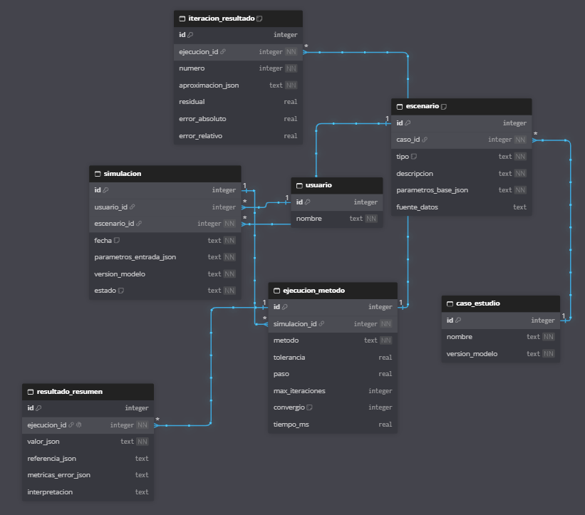
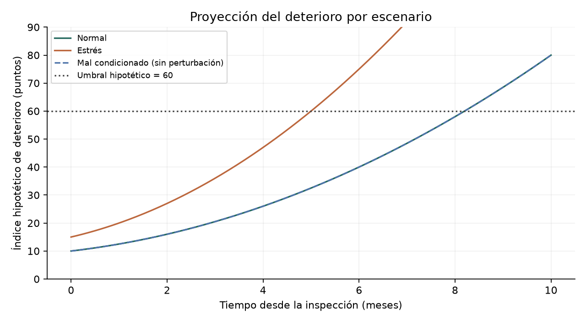
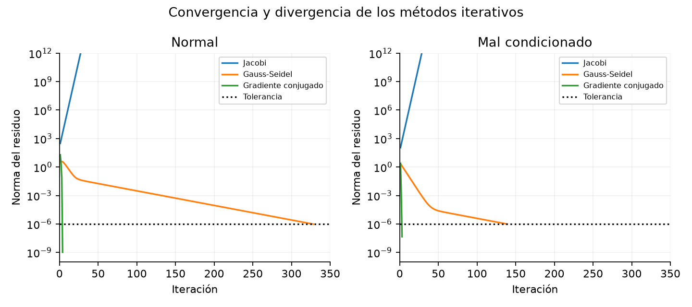
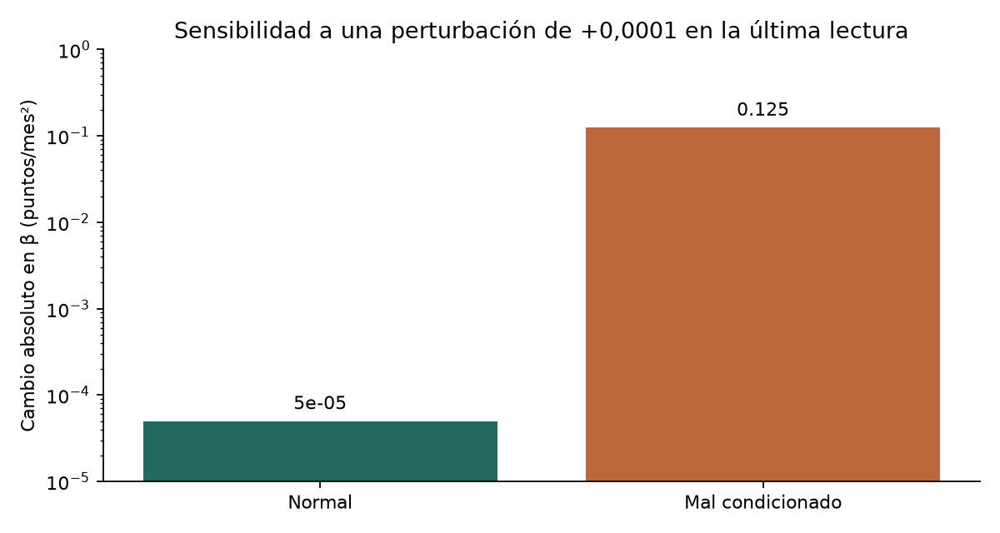

# SIMTELE-RISK: modelación numérica de escenarios hipotéticos en un sistema de transporte por cable

**Avance de investigación — Semana 1**  
**Asignatura:** Métodos Numéricos  
**Integrantes:**

- Univ. ______________________________
- Univ. ______________________________
- Univ. ______________________________
- Univ. ______________________________

## Resumen

Se presenta el planteamiento de SIMTELE-RISK, una aplicación educativa que estudia cuatro problemas inspirados en el transporte por cable: detención de emergencia, deterioro mecánico, oscilaciones por viento y reconstrucción de sensores. Se desarrolla una primera experiencia sobre el deterioro hipotético de un rodamiento, representado mediante un índice cuadrático y mediciones con sesgo constante. Una calibración independiente del instrumento permite identificar cuatro parámetros a partir de tres lecturas. Se resuelve el sistema asociado mediante Jacobi, Gauss-Seidel, factorización LU con pivoteo y gradiente conjugado, y se compara con una solución directa de las observaciones. En los escenarios normal y de estrés, el umbral supuesto se alcanza a los 8,198 y 5,000 meses, respectivamente. En el subexperimento mal condicionado, el número de condición de la matriz normal aumenta de aproximadamente 211 a 6,14 × 10⁷; una perturbación de 0,0001 puntos en una lectura modifica el coeficiente cuadrático 2.500 veces más que en el escenario normal. Jacobi no converge en los ejemplos ensayados. Se describen las limitaciones de los modelos, el prototipo web y el modelo de datos. Todos los datos son sintéticos y no constituyen un diagnóstico de un sistema real.

**Palabras clave:** métodos numéricos; sistemas lineales; condicionamiento; rodamiento; simulación; teoría de errores.

## 1. Introducción

El transporte por cable integra componentes mecánicos, estructuras, sensores y sistemas de operación cuya comprensión requiere modelos que relacionen variables y permitan evaluar la sensibilidad de sus resultados. En un contexto académico, estos modelos pueden utilizarse para contrastar aproximaciones numéricas con referencias conocidas y estudiar el efecto de datos inciertos.

SIMTELE-RISK se inspira en el contexto urbano de La Paz y El Alto, pero sus escenarios, mediciones y umbrales son hipotéticos. No se emplean datos operativos de Mi Teleférico ni se afirman fallas reales. La pregunta del estudio es cómo modelar cuatro problemas vinculados con transporte por cable y cómo medir la confiabilidad numérica de las soluciones obtenidas.

El objetivo de este avance es formular los cuatro casos, implementar una primera familia de métodos para sistemas lineales y estudiar tres escenarios en un caso de deterioro. Como objetivos específicos se plantean: definir variables y unidades; comparar resultados con una referencia independiente; calcular errores y residuos; investigar sensibilidad y condicionamiento; y presentar un prototipo web y un modelo de datos inicial.

## 2. Materiales y metodología

### 2.1. Casos y métodos previstos

| Módulo | Pregunta y modelo inicial | Variables y unidades principales | Métodos previstos |
|---|---|---|---|
| Detención de emergencia | Tiempo y distancia de parada. Durante la reacción se supone velocidad constante; durante el frenado, x′ = v y v′ = −a, con a constante. | Posición x (m), velocidad v (m/s), desaceleración a (m/s²), tiempo t y reacción tᵣ (s). | RK2, RK4, trapecio, Simpson 1/3, Romberg y búsqueda de raíces. |
| Deterioro mecánico | Tiempo hasta un umbral hipotético de inspección: D(t) = D₀ + αt + βt². | Índice D y sesgo s (puntos), t (meses), α (puntos/mes), β (puntos/mes²). | Sistemas lineales y, posteriormente, bisección, Newton-Raphson y secante. |
| Oscilaciones por viento | Movimiento lateral idealizado: x′ = v; v′ = (F(t) − cv − kx)/m. | Desplazamiento x (m), v (m/s), masa m (kg), fuerza F (N), amortiguamiento c (N·s/m), rigidez k (N/m). | RK2, RK4 e integración numérica. |
| Reconstrucción de sensores | Estimación de valores ocultados de una señal sintética y(t) = sin(t). | Tiempo t (s); y es una señal sintética adimensional. | Lagrange, Newton por diferencias divididas y splines cúbicos. |

En detención, para v₀ ≥ 0, a > 0 y tᵣ ≥ 0, las referencias son t_total = tᵣ + v₀/a y d_total = v₀tᵣ + v₀²/(2a). Se supone que el frenado comienza después de la reacción y no se modelan pendientes, fricción variable ni restricciones de capacidad del freno. En oscilaciones, m > 0, c ≥ 0 y k > 0 son parámetros idealizados; el caso de referencia puede ser una vibración libre subamortiguada con F(t) = 0. En sensores, la señal conocida permite ocultar puntos y medir la diferencia entre valores reconstruidos y verdaderos. Las condiciones iniciales y los valores concretos de estos tres módulos se determinarán en su implementación.

### 2.2. Definición de escenarios

| Caso | Normal | Estrés | Mal condicionado: subexperimento numérico |
|---|---|---|---|
| Detención | Velocidad, reacción y frenado nominales sintéticos. | Velocidad mayor o desaceleración menor. | Estimación de parámetros con sensibilidad demostrable; formulación y valores por verificar. |
| Deterioro | Lecturas en 0, 1 y 2 meses con crecimiento moderado. | Lecturas en los mismos tiempos con crecimiento acelerado. | Lecturas en 0, 0,02 y 0,04 meses; la proximidad dificulta estimar la curvatura. |
| Viento | Fuerza y amortiguamiento nominales supuestos. | Mayor fuerza o menor amortiguamiento. | Estimación sensible de parámetros del modelo; formulación y valores por verificar. |
| Sensores | Nodos regulares y datos consistentes. | Más puntos faltantes o mayor ruido. | Nodos desfavorables y sensibilidad de interpolación; configuración por verificar. |

Un escenario de estrés describe una condición más exigente del problema; el mal condicionamiento es una propiedad de sensibilidad del problema matemático. La falta de convergencia de un algoritmo es un fenómeno distinto. Los escenarios de los tres módulos sin simulador son planteamientos, no resultados experimentales.

### 2.3. Índice de deterioro y calibración

Se considera un rodamiento hipotético observado desde una inspección inicial, t = 0. El índice D(t), expresado en puntos, no es una medición directa ni una escala certificada. Se utiliza D = 60 puntos como umbral académico de recomendación de inspección; no representa un límite de falla.

\[
D(t)=D_0+\alpha t+\beta t^2,\qquad y(t)=D(t)+s.
\]

| Símbolo | Significado | Unidad |
|---|---|---|
| D(t), D₀ | Índice de deterioro y su valor inicial | puntos |
| α | Ritmo inicial de crecimiento | puntos/mes |
| β | Coeficiente cuadrático de crecimiento | puntos/mes² |
| s | Sesgo constante de medición | puntos |
| t | Tiempo desde la inspección | meses |
| U | Umbral hipotético de inspección | puntos |

Se supone que las tres lecturas comparten un mismo sesgo constante, que el índice sigue una curva cuadrática durante el intervalo analizado y que la calibración del instrumento se obtiene **independientemente**. Sin la cuarta observación, D₀ y s solo aparecerían como suma y no podrían identificarse por separado. El umbral se proyecta para crecimiento monótono, con α ≥ 0 y β ≥ 0; si D₀ ≥ U, el tiempo es cero. El modelo no predice desgaste físico detallado ni el instante de falla.

Para t₀ = 0, t₁ = h y t₂ = 2h, el vector de incógnitas es x = [D₀, α, β, s]ᵀ. Las lecturas y la calibración independiente generan:

\[
C x = y,\qquad
C=\begin{bmatrix}1&0&0&1\\1&h&h^2&1\\1&2h&4h^2&1\\0&0&0&1\end{bmatrix},\qquad
y=\begin{bmatrix}y_0\\y_1\\y_2\\s_{cal}\end{bmatrix}.
\]

Con h > 0, C tiene rango completo. Para aplicar los cuatro métodos a un mismo sistema simétrico definido positivo se forman las ecuaciones normales A = CᵀC y b = Cᵀy. La solución directa de Cx = y es la referencia, mientras que los métodos numéricos resuelven Ax = b. Las ecuaciones normales incrementan la sensibilidad: en norma 2, κ₂(CᵀC) = κ₂(C)² para C de rango completo.

### 2.4. Métodos, criterios y teoría de errores

Jacobi actualiza cada componente con los valores de la iteración anterior; Gauss-Seidel utiliza inmediatamente los componentes ya actualizados. La factorización LU con pivoteo resuelve el sistema mediante eliminación y sustitución. El gradiente conjugado estándar requiere una matriz simétrica definida positiva, condición satisfecha por A = CᵀC cuando C tiene rango completo [1, 2]. Para Jacobi y Gauss-Seidel la convergencia depende de la matriz de iteración; no se presupone que ambos converjan solo porque A sea definida positiva.

Se utiliza x⁽⁰⁾ = 0, tolerancia absoluta ε = 10⁻⁶ para la norma del residuo y un máximo de 1.000 iteraciones. Si el cálculo deja de ser finito, se interrumpe y se informa que no convergió. LU es directo y se muestra sin conteo de iteraciones. Para x* de referencia y una aproximación x̂ se usan:

\[
r=b-A\hat{x},\quad E_{abs}=\|\hat{x}-x^*\|_2,\quad
E_{rel}=\frac{E_{abs}}{\|x^*\|_2},\quad E_{\%}=100E_{rel}.
\]

El error relativo solo se define cuando ||x*||₂ ≠ 0; en caso contrario no se divide por cero. El residuo mide el cumplimiento del sistema, mientras que los errores miden la diferencia frente a la referencia. La sensibilidad se evalúa perturbando la última lectura en +0,0001 puntos. Los errores presentados corresponden a la calibración del módulo de deterioro; las tablas de errores de las otras familias y módulos aún no están implementadas.

## 3. Diseño del sistema y modelo de datos

El prototipo se organiza en una portada y cuatro páginas de módulo. Deterioro contiene el modelo, la notación, los escenarios, el simulador, las tablas y el historial. Las otras páginas presentan el planteamiento y se identifican como módulos en desarrollo. El usuario puede cambiar lecturas, sesgo, umbral y tolerancia, y comparar resultados y comportamiento de los métodos.

**Figura 1.** DER conceptual propuesto: casos, escenarios, simulaciones, ejecuciones, iteraciones y resultados. Una simulación puede incluir varios métodos; cada método puede registrar iteraciones y un resultado resumido. El usuario puede asociarse a múltiples simulaciones.

El diagrama representa el **diseño relacional propuesto**, no el esquema ya normalizado de la versión actual. La implementación usa Supabase Auth y una tabla `public.simulaciones` con identificador de usuario, caso, escenario, entradas y resultados JSON, versión de modelo y fecha. El acceso a filas está restringido al usuario autenticado mediante políticas RLS. Las iteraciones se conservan dentro de la instantánea de resultados y no en una tabla independiente. El historial vuelve a ejecutar las entradas con el modelo vigente. La prueba completa de guardado, cierre, recuperación y repetición con una cuenta real permanece pendiente; tampoco se ha probado la reconstrucción de versiones anteriores del modelo.

## 4. Experimentos y resultados

### 4.1. Datos de entrada y solución de referencia

En los tres casos se fija U = 60 puntos y s_cal = 3 puntos. Los valores son sintéticos; h indica el intervalo entre observaciones.

| Escenario | h (meses) | Lecturas (y₀, y₁, y₂) | Referencia (D₀, α, β, s) | Tiempo al umbral (meses) |
|---|---:|---|---|---:|
| Normal | 1 | (13; 15,5; 19) | (10; 2; 0,5; 3) | 8,198 |
| Estrés | 1 | (18; 23; 30) | (15; 4; 1; 3) | 5,000 |
| Mal condicionado | 0,02 | (13; 13,0402; 13,0808) | (10; 2; 0,5; 3) | 8,198 |

El escenario mal condicionado utiliza la misma curva de referencia que el normal, pero mide durante una ventana temporal mucho más corta. Por ello, la diferencia principal del experimento es la información disponible para estimar los parámetros, no un mayor deterioro físico.

**Ejemplo manual — escenario normal.** De la calibración se obtiene s = 3. Para t = 0, D₀ + 3 = 13, por lo que D₀ = 10. Las lecturas siguientes dan α + β = 2,5 y 2α + 4β = 6; de allí β = 0,5 y α = 2. Se resuelve 10 + 2t + 0,5t² = 60. La raíz no negativa es t = −2 + √104 ≈ 8,198 meses.

**Ejemplo manual — escenario de estrés.** Con s = 3, la primera lectura da D₀ = 15. Las otras dos proporcionan α + β = 5 y 2α + 4β = 12; por tanto, α = 4 y β = 1. De 15 + 4t + t² = 60 se obtiene t = 5 meses.

**Ejemplo manual — escenario mal condicionado.** Las lecturas corregidas por el sesgo son 10; 10,0402 y 10,0808. Para h = 0,02: 0,02α + 0,0004β = 0,0402 y 0,04α + 0,0016β = 0,0808. La solución exacta de estos datos ideales es α = 2 y β = 0,5; el cruce es 8,198 meses. La cercanía de las observaciones hace sensible esta estimación, como se comprueba en la sección 4.4.

**Figura 2.** Curvas de referencia; normal y mal condicionado coinciden antes de perturbar los datos. La línea horizontal representa el umbral hipotético.

### 4.2. Matrices de los sistemas y referencias

Para los escenarios normal y estrés, h = 1 y se utiliza la misma matriz:

\[
A_{1}=\begin{bmatrix}3&3&5&3\\3&5&9&3\\5&9&17&5\\3&3&5&4\end{bmatrix},\quad
b_{normal}=\begin{bmatrix}47,5\\53,5\\91,5\\50,5\end{bmatrix},\quad
b_{estrés}=\begin{bmatrix}71\\83\\143\\74\end{bmatrix}.
\]

Las soluciones de referencia son, respectivamente, x* = [10; 2; 0,5; 3]ᵀ y x* = [15; 4; 1; 3]ᵀ. Para h = 0,02:

\[
A_{mal}=\begin{bmatrix}
3&0,06&0,002&3\\
0,06&0,002&0,000072&0,06\\
0,002&0,000072&0,00000272&0,002\\
3&0,06&0,002&4
\end{bmatrix},\quad
b_{mal}=\begin{bmatrix}39,121\\0,784036\\0,02614536\\42,121\end{bmatrix}.
\]

Su referencia es x* = [10; 2; 0,5; 3]ᵀ. Las matrices son simétricas definidas positivas porque provienen de CᵀC con C de rango completo. Las condiciones estimadas son κ₂(A₁) ≈ 211,02 y κ₂(A_mal) ≈ 6,14 × 10⁷. El primer sistema tampoco tiene condición cercana a 1; se usa como referencia comparativa frente al sistema mucho más sensible.

### 4.3. Comparación numérica y tablas de error

Los valores se obtuvieron con los algoritmos de `math.js`, aritmética de punto flotante y las entradas de la tabla 4.1. Se redondean a tres cifras significativas. Un guion indica que la magnitud correspondiente dejó de ser finita en la ejecución; no significa error cero.

**Tabla 1. Escenario normal.**

| Método | Iteraciones | Estado | ||r||₂ | Error absoluto | Error relativo | Error % |
|---|---:|---|---:|---:|---:|---:|
| LU con pivoteo | Directo | Resuelto | 0 | 9,49 × 10⁻¹⁶ | 8,91 × 10⁻¹⁷ | 8,91 × 10⁻¹⁵ |
| Jacobi | 847 | No convergió; desbordamiento | — | 1,97 × 10³⁰⁷ | 1,85 × 10³⁰⁶ | — |
| Gauss-Seidel | 328 | Convergió | 9,67 × 10⁻⁷ | 7,43 × 10⁻⁶ | 6,98 × 10⁻⁷ | 6,98 × 10⁻⁵ |
| Gradiente conjugado | 4 | Convergió | 1,04 × 10⁻⁹ | 4,10 × 10⁻¹¹ | 3,85 × 10⁻¹² | 3,85 × 10⁻¹⁰ |

**Tabla 2. Escenario de estrés.**

| Método | Iteraciones | Estado | ||r||₂ | Error absoluto | Error relativo | Error % |
|---|---:|---|---:|---:|---:|---:|
| LU con pivoteo | Directo | Resuelto | 0 | 1,90 × 10⁻¹⁵ | 1,20 × 10⁻¹⁶ | 1,20 × 10⁻¹⁴ |
| Jacobi | 846 | No convergió; desbordamiento | — | 1,30 × 10³⁰⁷ | 8,20 × 10³⁰⁵ | 8,20 × 10³⁰⁷ |
| Gauss-Seidel | 347 | Convergió | 9,88 × 10⁻⁷ | 7,59 × 10⁻⁶ | 4,79 × 10⁻⁷ | 4,79 × 10⁻⁵ |
| Gradiente conjugado | 4 | Convergió | 1,25 × 10⁻⁹ | 4,92 × 10⁻¹¹ | 3,11 × 10⁻¹² | 3,11 × 10⁻¹⁰ |

**Tabla 3. Escenario mal condicionado.**

| Método | Iteraciones | Estado | ||r||₂ | Error absoluto | Error relativo | Error % |
|---|---:|---|---:|---:|---:|---:|
| LU con pivoteo | Directo | Resuelto | 1,11 × 10⁻¹⁶ | 9,64 × 10⁻¹² | 9,05 × 10⁻¹³ | 9,05 × 10⁻¹¹ |
| Jacobi | 843 | No convergió; desbordamiento | — | — | — | — |
| Gauss-Seidel | 139 | Criterio de residuo satisfecho | 9,73 × 10⁻⁷ | 3,82 × 10⁻² | 3,59 × 10⁻³ | 0,359 |
| Gradiente conjugado | 3 | Criterio de residuo satisfecho | 4,48 × 10⁻⁸ | 4,21 × 10⁻¹ | 3,96 × 10⁻² | 3,96 |

La marca de convergencia de los métodos iterativos indica únicamente que se satisfizo el criterio de residuo. En el caso mal condicionado, ese criterio admite un error de parámetros considerable: el residuo de gradiente conjugado es menor que 10⁻⁶, pero su error relativo respecto de la referencia es aproximadamente 3,96 %. LU muestra un residuo impreso como cero en los dos primeros escenarios debido a la aritmética de la ejecución, no una garantía de exactitud matemática universal.

**Figura 3.** Evolución de los residuos en escalas logarítmicas para los casos normal y mal condicionado. Se muestra la ventana de las primeras 350 iteraciones y residuos entre 10⁻¹⁰ y 10¹² para facilitar la lectura; los valores que exceden la ventana quedan fuera del gráfico. La aplicación presenta las iteraciones finitas registradas.

### 4.4. Sensibilidad a las mediciones

Se incrementa únicamente la última lectura en 0,0001 puntos, manteniendo las demás entradas. Se vuelve a resolver Cx = y directamente. El cambio de β es 0,00005 puntos/mes² en el caso normal y 0,125 puntos/mes² en el mal condicionado: un factor de **2.500**. En este último, β pasa de 0,5 a 0,625. Este experimento evidencia la sensibilidad del problema; no atribuye la diferencia a un mayor riesgo físico.

**Figura 4.** Cambio absoluto de β ante la misma perturbación de entrada, en escala logarítmica.

## 5. Discusión

En el modelo físico hipotético, el escenario de estrés alcanza el umbral 3,198 meses antes que el normal. La diferencia se debe a que parte de un índice mayor y presenta coeficientes de crecimiento superiores. El resultado depende de los valores supuestos y de que la curva siga siendo válida hasta el umbral; no demuestra daño real de ningún rodamiento.

En el análisis numérico, LU y gradiente conjugado resolvieron con pequeños errores los ejemplos normal y de estrés para la tolerancia seleccionada. Gauss-Seidel requirió cientos de iteraciones. Jacobi diverge con las matrices elegidas y termina por desbordamiento; esto debe mostrarse como un resultado del método, no ocultarse ni atribuirse automáticamente al escenario físico. El caso mal condicionado demuestra que una norma de residuo pequeña no asegura parámetros precisos.

Las ecuaciones normales hacen posible comparar los métodos sobre una misma matriz definida positiva, pero empeoran el condicionamiento. Para un estudio de calibración de mayor exigencia convendría contrastar con métodos basados directamente en C, como QR, y considerar más observaciones y un modelo de medición validado [1]. La interpretación también está limitada por la elección de un indicador sintético, un sesgo constante y la ausencia de mantenimiento o cambios operativos dentro del intervalo proyectado.

## 6. Conclusiones

**Conclusión numérica.** La referencia directa permite medir errores de las soluciones de Ax = b. La comparación de los tres casos confirma divergencia de Jacobi y la importancia de considerar la sensibilidad y el error, además del residuo. En el caso mal condicionado, el criterio de parada basado solo en el residuo resultó insuficiente para garantizar una estimación precisa de los parámetros.

**Conclusión del problema.** Bajo los supuestos y datos sintéticos escogidos, el índice del rodamiento alcanzaría el umbral de inspección a los 8,198 meses en el caso normal y a los 5 meses en estrés. El resultado es educativo y no permite inferir fallas reales ni establecer intervalos de mantenimiento para equipos operativos.

**Alcance de la semana 1.** Se formularon los cuatro casos y sus escenarios, se construyó el prototipo y se realizaron pruebas de sistemas lineales en los tres escenarios de deterioro. Permanecen pendientes la validación de escenarios mal condicionados de los otros módulos, tablas de error en esos módulos, la prueba integral de persistencia y el desarrollo de las demás familias numéricas. Estas limitaciones impiden considerar terminada toda la evidencia transversal exigida por la consigna.

## Referencias

[1] T. Sauer, *Numerical Analysis*, 3.ª ed., Pearson, 2018.

[2] R. L. Burden, J. D. Faires y A. M. Burden, *Numerical Analysis*, 10.ª ed., Cengage Learning, 2016.

[3] Consigna académica, *Desafío Integrador SIMTELE-RISK: Métodos Numéricos*, secciones 3–10, documento proporcionado para el proyecto.

[4] SIMTELE-RISK, código fuente y simulador, [repositorio del proyecto](https://github.com/iTzManix/teleferico) y [aplicación web](https://itzmanix.github.io/teleferico/).
